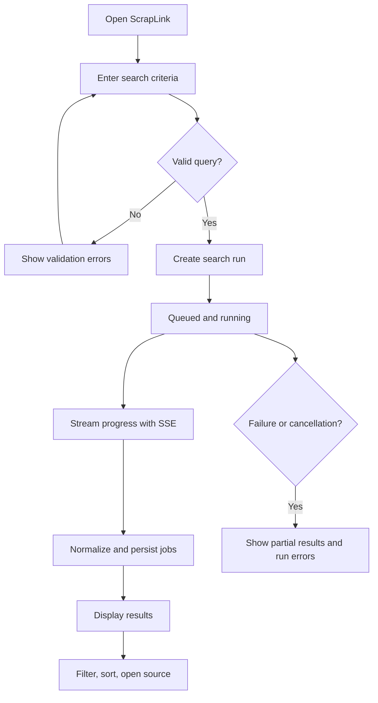

# ScrapLink — Product Requirements Document (PRD)

| Attribute | Value |
|---|---|
| Product | ScrapLink |
| Document | Product Requirements Document |
| Version | 1.0 — Draft for review |
| Date | 2026-10-08 |
| Status | Proposed product specification |
| Related documents | [BRD.md](./BRD.md), [TRD.md](./TRD.md) |

## 1. Product definition

ScrapLink is a browser-based job-discovery dashboard. A user creates a search, a Python background worker collects listings from **enabled, authorized** sources, and the user sees normalized job records and the progress of the search.

**Product vision:** discover active and newly posted jobs, originally with LinkedIn as the target. **Delivery constraint:** automated LinkedIn collection requires an approved source-access method; until then, the product must work against permitted sources and must not claim LinkedIn coverage. The source connector is replaceable.

## 2. Users and scenarios

### Primary persona: internal job researcher (MVP proposal)

Wants to identify recent roles by title and geography without repeatedly opening each permitted source. Needs direct links, posting time, company information, and confidence about job availability.

### Core use cases

- UC-01: Search for `Software Engineer` roles in `United States`, posted in the past 24 hours.
- UC-02: Monitor a submitted search while collection is running.
- UC-03: Open a job's original source page.
- UC-04: Review source errors when a run only partly succeeds.
- UC-05: Re-run the same query and see updated discovery/verification timestamps without duplicate cards.
- UC-06: Filter and sort accumulated results.

## 3. Product principles

1. **Truthful freshness:** show both posted time and first/last-seen time.
2. **Status honesty:** never equate 'fetched' with 'active' without evidence.
3. **Attribution:** every result has a source label and valid source URL.
4. **Partial results are useful:** do not hide successful records because a later page failed.
5. **Swappable providers:** UI and database do not depend on a particular website's HTML.
6. **Visible limits:** show when date, location, description, or status cannot be confirmed.

## 4. MVP user flow

## 5. Screens

### 5.1 Search & results page (`/`)

**Search form**

| Field | Type | Requirement | Default / behavior |
|---|---|---|---|
| Job title or keywords | Text | Required; trim whitespace | Empty |
| Location | Text | Optional | Empty = no geography filter where supported |
| Posted within | Select | Required | Last 24 hours |
| Source | Select | Optional | All enabled/approved sources |
| Search | Button | Enabled with valid input | Creates one run |

Date choices for MVP: `24 hours`, `7 days`, `30 days`, `Any time`. The UI must distinguish **source-side filters** from **post-collection filters**; sources may not support identical search capabilities. If a query cannot be faithfully applied, the run must indicate the limitation.

**Top-level state**

- Search run status: queued, running, completed, completed with errors, failed, cancelled.
- Counters: pages visited, raw listings seen, valid listings, new jobs, updated jobs, duplicates skipped, extraction failures.
- Last progress update time and readable error message (when applicable).
- Clear indicator when SSE is reconnecting; never invent progress.

**Results list/table**

| Column | Behavior |
|---|---|
| Job title | Primary title; link to detail drawer or source |
| Company | Text, `Not provided` if missing |
| Location | Raw and normalized display if possible |
| Posted | Absolute date if known; approximate label if source is relative |
| Activity | `Active`, `Unknown`, `Closed` |
| Source | Provider name and original link |
| First seen | UTC-derived localized timestamp |
| Last checked | UTC-derived localized timestamp if checked |

Include filters for source, posting range, company text and activity status; sort by posted date (when comparable), first seen, company and title. Pagination on server is required, even when the first pilot dataset is small. Missing posting dates sort after known dates unless user explicitly chooses otherwise.

### 5.2 Run details view (`/runs/:runId`)

Display query, source selection, creation/start/end timestamps, live status, counters, and structured errors. Provide visible partial results and a link back to the search page.

### 5.3 Job details panel (`/jobs/:jobId` or drawer)

Display normalized fields, description if source licensing permits, original description excerpt if permitted, source link, posting timestamp and precision, discovery times, check outcome, and any warning (`posting date uncertain`, `source unavailable`).

## 6. Functional requirements

Priority: **P0** required for MVP; **P1** desirable after MVP; **P2** future.

| ID | Priority | Requirement | Acceptance condition |
|---|---|---|---|
| FR-01 | P0 | Create a job search | Valid input creates a run ID; invalid input returns inline errors |
| FR-02 | P0 | Validate supported sources | Disabled/unapproved sources cannot be started |
| FR-03 | P0 | Background execution | HTTP request returns before long collection finishes |
| FR-04 | P0 | Collect permitted job listing pages | Test source produces normalized job records |
| FR-05 | P0 | Extract core fields | Provider, URL, title plus available company/location/dates are stored |
| FR-06 | P0 | Deduplicate | Same provider job ID/canonical URL does not create repeated rows |
| FR-07 | P0 | Persist runs/results | Restarting API does not erase data |
| FR-08 | P0 | SSE progress | Running client receives run-specific status and count updates |
| FR-09 | P0 | Reconnect and resync | Client resumes via snapshot fetch after SSE disruption |
| FR-10 | P0 | List/filter/sort jobs | Server supports pagination and stable ordering |
| FR-11 | P0 | View provenance | Every listing shows provider and direct original URL |
| FR-12 | P0 | Status semantics | Activity is `unknown` unless validated using supported evidence |
| FR-13 | P0 | Error transparency | Partial failures visible without wiping successful data |
| FR-14 | P0 | Cancel run | User can request cancellation; worker stops at safe checkpoints |
| FR-15 | P1 | Saved searches | User can reuse previous criteria |
| FR-16 | P1 | Scheduled searches | Recurrent permitted collection with rate budgets |
| FR-17 | P1 | Export results | CSV of data permitted for export |
| FR-18 | P1 | Reverification | Selected job status can be rechecked through approved source |
| FR-19 | P2 | Multiple users | Accounts and scoped data isolation |
| FR-20 | P2 | AI ranking | Rank jobs against user-specified criteria |

## 7. Validation and field definitions

### Search request

- `keywords`: 1–200 visible characters after trimming; reject whitespace-only values.
- `location`: optional 0–200 characters.
- `posted_within`: one of `24h`, `7d`, `30d`, `any`.
- `sources`: optional array of enabled provider IDs; `[]` or omitted means all approved enabled sources.
- `max_results`: optional server-bounded number; frontend does not override global safety limits.

### Job record

**Required:** internal ID, source/provider ID, source URL, title, first-seen UTC, last-seen UTC.

**Optional:** source job ID, company, location, remote type, employment type, description, posting date, posting-date precision, last-verified UTC, activity status and evidence type. Missing information stays `null`/`unknown` and is not guessed.

**Posting date precision:** `exact`, `date_only`, `relative_estimate`, `unknown`. Preserve the source's original date string where permitted. For relative strings, anchor any estimated calculation to the UTC fetch time.

**Activity:**
- `active`: a documented source signal indicates applications are open, with a recent check time.
- `closed`: an explicit source signal confirms closure, with a check time.
- `unknown`: missing or ambiguous evidence, or a source error.

**Note:** No source is required to provide all optional fields. The UI should degrade gracefully.

## 8. Product interaction details

### 8.1 Submission

- Disable repeated clicks during the create request; use an idempotency key to avoid accidental duplicate runs.
- After successful submission, show run status immediately and subscribe to that run's events.
- The search form may remain editable, but a running task uses an immutable snapshot of the original query.

### 8.2 Progress and SSE

- On initial load, GET a current run snapshot **before** relying on the live stream.
- Stream events are advisory and not the database source of truth.
- If the connection drops, show `Reconnecting...`, reconnect, and refresh the snapshot.
- Progress counts can increase throughout the run. Display an indeterminate progress indicator unless the total work is actually known.

### 8.3 Empty, partial, and error states

- No matches: `No jobs found for this query` with actual checked sources and constraints.
- Source unsupported: `This source is unavailable for automated collection.`
- Partial run: `Some sources or pages could not be checked. Showing available results.`
- Failed run: preserve diagnostic info; do not imply that no jobs exist.
- Date absent: `Posted date unavailable`, not a fabricated timestamp.

### 8.4 Duplicate behavior

An existing job from the same source should be updated with `last_seen_at`, available changed fields, and new verification evidence rather than duplicated. Cross-source matches should **not** be automatically merged without strong evidence; different listings might represent distinct openings.

### 8.5 Cancellation

- Cancel action marks the run `cancelling` as a transitional internal state.
- The worker checks cancellation at task boundaries, stops scheduling new pages, and moves to `cancelled`.
- Already saved records remain visible; no guarantee of instantly terminating an in-flight browser operation.

## 9. Nonfunctional product requirements

| ID | Requirement |
|---|---|
| NFR-01 | Responsive desktop-first layout, usable at mobile widths |
| NFR-02 | Accessible labels, keyboard actions, visible loading/error states |
| NFR-03 | PII minimization; do not ingest candidate/member profiles in MVP |
| NFR-04 | No credentials or browser session cookies visible to frontend |
| NFR-05 | Every page supports pagination, bounded filters, predictable sort |
| NFR-06 | Browser worker failures must not crash the API process |
| NFR-07 | All saved timestamps timezone-aware UTC |
| NFR-08 | Source restrictions and acquisition permission enforced in backend |
| NFR-09 | Structured logs with run ID and source ID; avoid logging secrets |
| NFR-10 | Works locally using documented startup steps |

Performance benchmarks and uptime objectives are to be established from a source-approved pilot; they are not guaranteed here.

## 10. Acceptance test scenarios

| ID | Given | When | Then |
|---|---|---|---|
| AT-01 | Search input is blank | Search clicked | Inline validation; no run created |
| AT-02 | Approved test source is enabled | Valid query submitted | Run ID returned and job discovery begins |
| AT-03 | Worker finds three valid listings | Results refresh | Three attributed records displayed |
| AT-04 | Same provider ID appears twice | Both parsed | One job persisted, duplicate counted |
| AT-05 | Posting timestamp absent | Job displayed | `Posted date unavailable` shown |
| AT-06 | Listing page loads but no status signal | Job stored | Activity = `unknown` |
| AT-07 | Explicit source closure signal is parsed | Status check succeeds | Activity = `closed`, evidence recorded |
| AT-08 | One page errors after earlier successes | Run finishes | Existing jobs remain and run says partial/errors |
| AT-09 | SSE disconnects | Client reconnects | Snapshot restores current counts/status |
| AT-10 | User cancels active run | Worker reaches checkpoint | Run stops scheduling work, ends cancelled |
| AT-11 | Unauthorized source selected | API receives request | Source rejected with safe explanation |
| AT-12 | User opens a job | Original link clicked | Browser opens stored, validated source URL |

## 11. MVP versus future roadmap

**Phase A — foundation:** repo structure, backend health endpoint, database, UI skeleton, source interface.

**Phase B — technical proof:** Scrapling rendering/parser and extraction against an approved or controlled fixture; schema and contract tests.

**Phase C — working MVP:** queue/worker, run lifecycle, persistence, SSE, filters, pagination and cancellation.

**Phase D — quality:** robust fixtures, dedupe tests, status verification, monitoring, deployment.

**Later:** saved searches, scheduling, exports, accounts, advanced ranking, more licensed sources.

## 12. Dependencies, blockers, and unresolved decisions

- Confirm first permitted source(s), and whether they offer query, pagination, and status evidence.
- Confirm whether LinkedIn provides an authorized method suitable for this product. Without one, exclude direct LinkedIn collection from released functionality.
- Confirm initial supported location(s) and whether text-only location is adequate.
- Decide allowed description retention/display from source terms.
- Confirm whether MVP is local-only single-user or hosted with authentication.
- Define telemetry/retention policy for crawl artifacts and errors.

## 13. References

- [BRD — business strategy and compliance](./BRD.md)
- [TRD — implementation contracts](./TRD.md)
- Scrapling docs: https://scrapling.readthedocs.io/en/latest/
- LinkedIn prohibited software: https://www.linkedin.com/help/linkedin/answer/a1341387/prohibition-of-scraping-software
